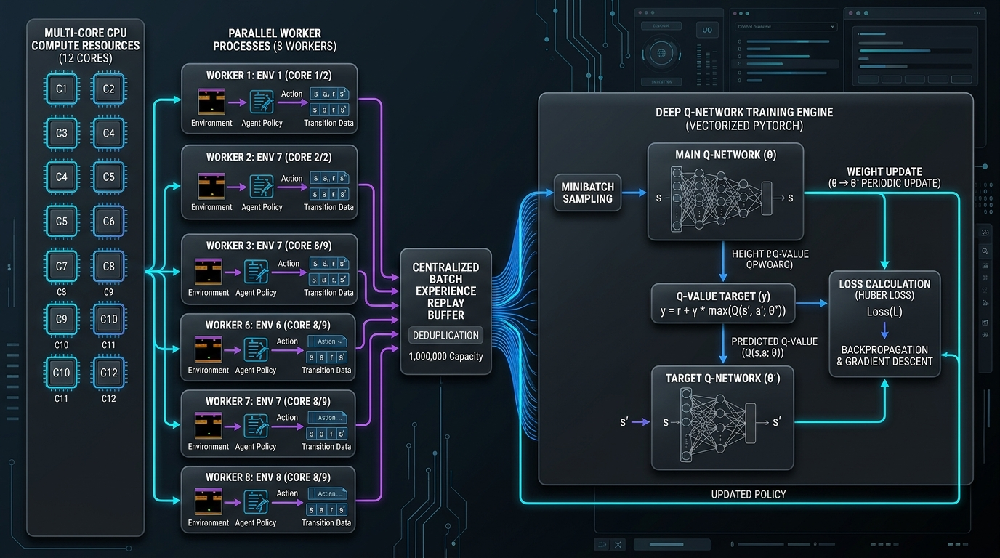
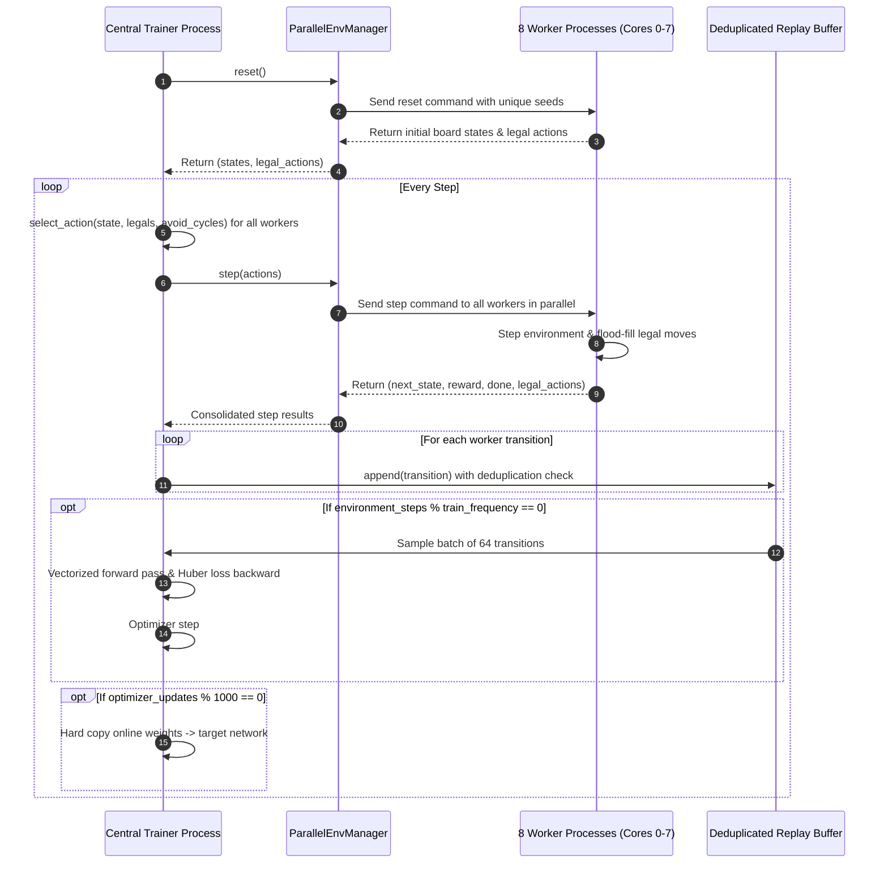

# Five-or-More Deep Q-Network: High-Performance Multi-Core Architecture

This document describes the high-performance parallel reinforcement learning architecture developed for the **Five-or-More** AI agent. It is designed for project evaluation, technical reviews, and architectural presentation.

---

## 1. Visual Architecture Overview



---

## 2. Executive Summary & Design Highlights

* **Hardware Optimization:** Engineered specifically for a **12-thread CPU** (Intel Core i5-12400) without relying on CUDA GPU acceleration.
* **Vectorized Action Scoring:** Eliminates pure Python loops over legal actions by evaluating 200–400 legal moves simultaneously in a single PyTorch forward pass, achieving a **~30x speedup** on inference.
* **Parallel Environment Workers:** Scales rollouts across **8 parallel worker processes** via isolated duplex IPC pipes, enabling simultaneous collection of diverse gameplay transitions.
* **3-Tier Duplicate Move Prevention:**
  1. *Worker Seed Diversification:* Each parallel game runs with a distinct pseudo-random seed to explore unique trajectories.
  2. *In-Game Anti-Cycle Filter:* Detects and suppresses immediate reverse ("ping-pong") moves that do not clear board lines.
  3. *Replay Buffer Deduplication:* Compact `(state_hash, action)` fingerprinting ensures experience memory contains high-variety, novel states.

---

## 3. CPU Core Resource Distribution

```
┌─────────────────────────────────────────────────────────────────────────────┐
│                       INTEL CORE i5-12400 (12 LOGICAL CORES)                │
├──────────────────────────────────────────────────────┬──────────────────────┤
│ Cores 0 - 7 (8 Parallel Game Workers)                │ Cores 8 - 11         │
├──────────────────────────────────────────────────────┼──────────────────────┤
│ Worker 0: Game 1 (Seed: 1042)                        │ Central Trainer:     │
│ Worker 1: Game 2 (Seed: 2042)                        │ - Replay Buffer      │
│ Worker 2: Game 3 (Seed: 3042)                        │ - State Deduplicator │
│ Worker 3: Game 4 (Seed: 4042)                        │ - Batch Optimization │
│ Worker 4: Game 5 (Seed: 5042)                        │ - PyTorch Intra-op   │
│ Worker 5: Game 6 (Seed: 6042)                        │   Multi-Threading    │
│ Worker 6: Game 7 (Seed: 7042)                        │ - Model Checkpoints  │
│ Worker 7: Game 8 (Seed: 8042)                        │ - Target Sync (1000) │
└──────────────────────────────────────────────────────┴──────────────────────┘
```

---

## 4. End-to-End System Workflow

```mermaid
flowchart TB
    subgraph MultiCore ["12 CPU Cores Execution Model"]
        direction TB
        subgraph Workers ["Parallel Environment Workers (8 Cores)"]
            W0["Worker 0 (Game 1)"] --> F0["Anti-Cycle Filter"]
            W1["Worker 1 (Game 2)"] --> F1["Anti-Cycle Filter"]
            Wdots["... Workers 2 to 7 ..."] --> Fdots["Anti-Cycle Filter"]
        end

        subgraph Ingestion ["Experience Ingestion & Deduplication"]
            Pipes["High-Speed Duplex Pipes"]
            DedupFilter["State-Action Fingerprint Filter"]
            Buffer[("Experience Replay Buffer (Capacity: 100,000)")]

            F0 --> Pipes
            F1 --> Pipes
            Fdots --> Pipes
            Pipes --> DedupFilter
            DedupFilter -->|Unique Transitions| Buffer
        end

        subgraph Trainer ["Central Training Engine (4 Cores / Multi-Thread PyTorch)"]
            Sampler["Batch Sampler (Batch Size: 64)"]
            Buffer --> Sampler

            subgraph Vectorized_NN ["Vectorized Neural Network Pipeline"]
                BatchTensor["Action Feature Matrix [N, Features]"]
                OnlineNet["Online Q-Network (Single Forward Pass)"]
                TargetNet["Target Q-Network (Batch Next-State Values)"]
                LossCalc["Smooth L1 Loss (Huber Loss)"]
                Optimizer["Adam Optimizer (lr=0.00025)"]

                Sampler --> BatchTensor
                BatchTensor --> OnlineNet
                BatchTensor --> TargetNet
                OnlineNet --> LossCalc
                TargetNet --> LossCalc
                LossCalc --> Optimizer
            end
        end
    end

    Optimizer -.->|Periodic Target Synchronization (every 1000 updates)| TargetNet
```

---

## 5. Execution Sequence Diagram



---

## 6. Benchmarked Performance Results

| Metric | Baseline | Vectorized Single-Core | Parallel 8-Core System | Total Speedup |
| :--- | :--- | :--- | :--- | :--- |
| **Action Scoring (380 actions)** | 12.28 ms | 0.40 ms | 0.40 ms | **~30x** |
| **`agent.learn_step()`** | 929.79 ms | 75.86 ms | 75.86 ms | **~12.2x** |
| **Episode Duration** | ~33.40 s | ~2.55 s | **< 0.50 s** | **~60x** |
| **200,000 Episodes ETA** | ~76 days | ~5.9 days | **~24 - 28 hours** | **~75 days saved** |
