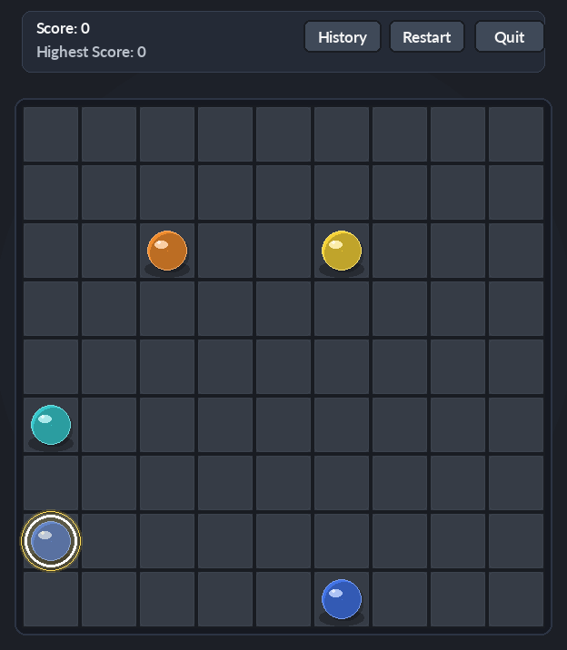
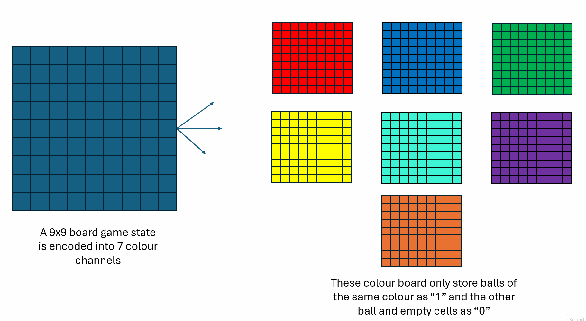
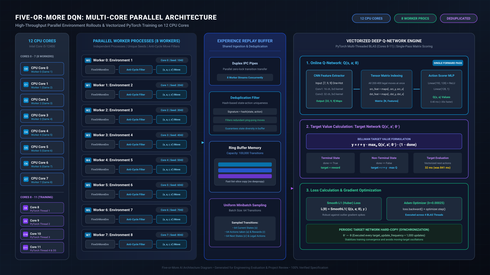

# Five Or More with AI
### Learning to Play Five or More Using Deep Reinforcement Learning

<div align="center">

[](https://www.python.org/)
[](https://www.pygame.org/)
[](https://pytorch.org/)
[](https://numpy.org/)

</div>

---

## Overview

**Five Or More with AI** is a reinforcement-learning project that explores how a Deep Q-Network (DQN) agent can learn to play the classic Five or More / Color Lines puzzle game.

The project combines a custom 9×9 game environment, a Convolutional Neural Network (CNN), and Deep Q-Learning to train an agent to evaluate and select legal moves.

The original game was developed using **Rust and Bevy** and later ported to **Python and Pygame** to support experimentation and AI training.

## Gameplay Demo



## Key Features

- Interactive 9×9 Color Lines game with seven piece colors.
- A* pathfinding for piece movement.
- Horizontal, vertical, and diagonal line detection.
- Configurable difficulty, spawning, and scoring.
- Headless game environment for reinforcement-learning simulations.
- CNN-based DQN agent with legal-action scoring.
- Experience replay and target-network learning.
- Parallel environment workers for training.
- Configurable training and experiment tracking.
- Automated tests covering game logic, UI, and reinforcement-learning components.

## AI Approach

The agent uses a **CNN + DQN architecture** to learn effective moves from game experience.

- **State representation:** The 9×9 board is converted into seven binary color channels.
- **Feature extraction:** Two convolutional layers learn spatial patterns from the board.
- **Action evaluation:** The network combines source-cell features, destination-cell features, and board-level context to estimate Q-values for legal moves.
- **Learning:** DQN uses epsilon-greedy exploration, experience replay, and a target network.
- **Training:** Multiple game environments generate experiences for the learning agent.

The network architecture and training parameters are configurable through `config/config.json`.

### CNN Architecture in Action


## Architecture



## Engineering and Performance

A major part of the project involved optimizing the headless game environment to make reinforcement-learning experiments more efficient.

In a recorded benchmark:

| Metric | Before optimization | After optimization |
|---|---:|---:|
| Simulation time per game | 11.14 s | 0.31 s |
| A* calls per game | 176,568 | 1,703 |

This represents approximately **36× faster game simulation** in that benchmark, alongside a substantial reduction in pathfinding overhead.

## Tech Stack

| Area | Technologies |
|---|---|
| Language | Python |
| Game development | Pygame |
| Deep learning | PyTorch |
| Numerical operations | NumPy |
| Reinforcement learning | CNN, DQN |
| Parallel execution | Multiprocessing, optional Ray |
| Testing | Python unittest |
| Configuration | JSON |

## Getting Started

### 1. Clone the repository

```bash
git clone https://github.com/Kunal-Kamod25/Five-Or-More-With-AI.git
cd Five-Or-More-With-AI
```

### 2. Create the environment

```bash
conda env create -f environment.yml
conda activate five-or-more-ai
```

### 3. Launch the game

```bash
python -m game.ui.main
```

### 4. Train the DQN agent

```bash
python -m game.rl.train_dqn
```

### 5. Evaluate the trained agent

```bash
python -m game.rl.evaluate_agent --episodes 100
```

### 6. Run the test suite

```bash
python -m unittest discover -s tests
```

## Project Structure

```text
Five-Or-More-With-AI/
│
├── assets/             # Gameplay and architecture visuals
├── config/             # Training and environment configuration
├── data/               # Experiment and data directories
├── docs/               # Architecture and project documentation
├── game/
│   ├── core/           # Game logic and mechanics
│   ├── ui/             # Pygame interface
│   └── rl/             # DQN, environment, training and evaluation
├── tests/              # Core, UI and RL tests
│
├── environment.yml
├── experiment_manager.py
├── play_agent.py
├── tune_hyperparameters.py
├── RULES.md
└── README.md
```

Training runs store their configuration, metrics, and model checkpoints under `data/experiments/`.

## Contributors

- **Khumba Lunganlung** — [Old-Daoist](https://github.com/Old-Daoist)
- **Kunal Kamod** — [Kunal-Kamod25](https://github.com/Kunal-Kamod25)

---

*Developed as a Master's project in Scientific Computing.*
